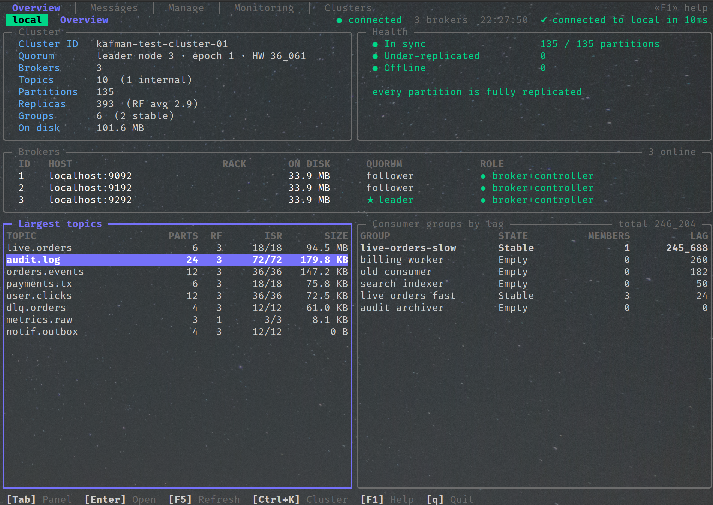
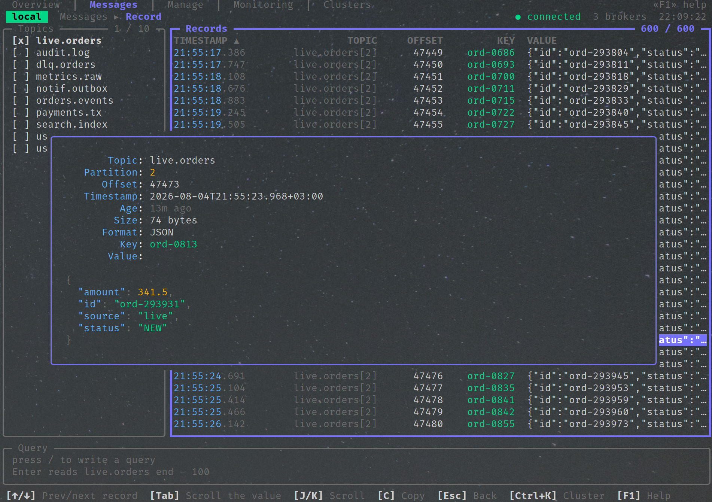
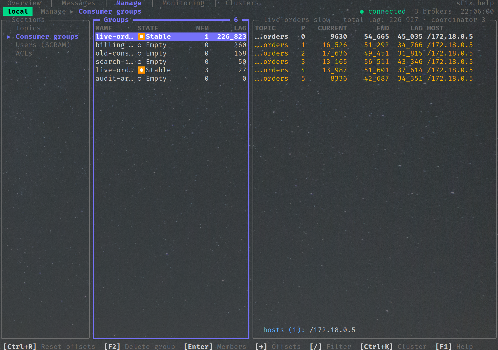
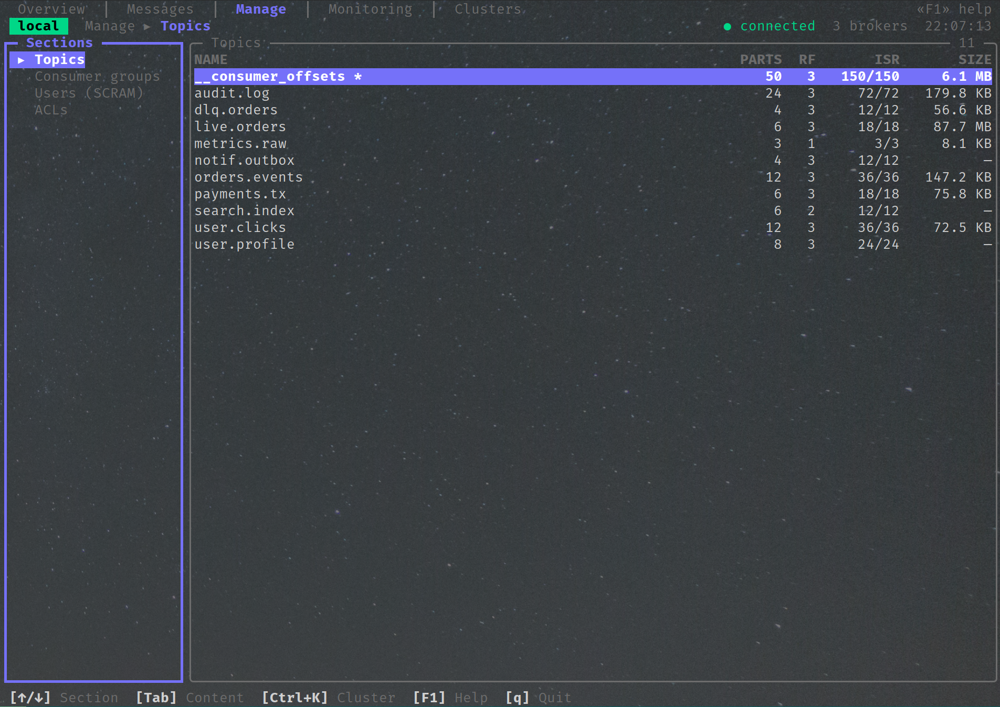
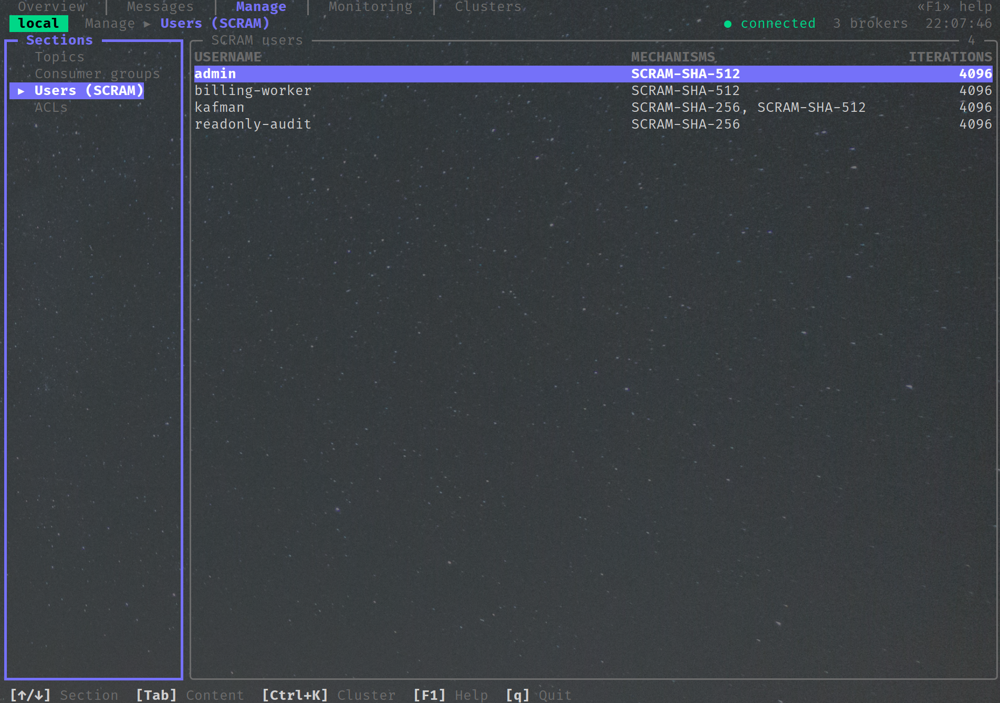
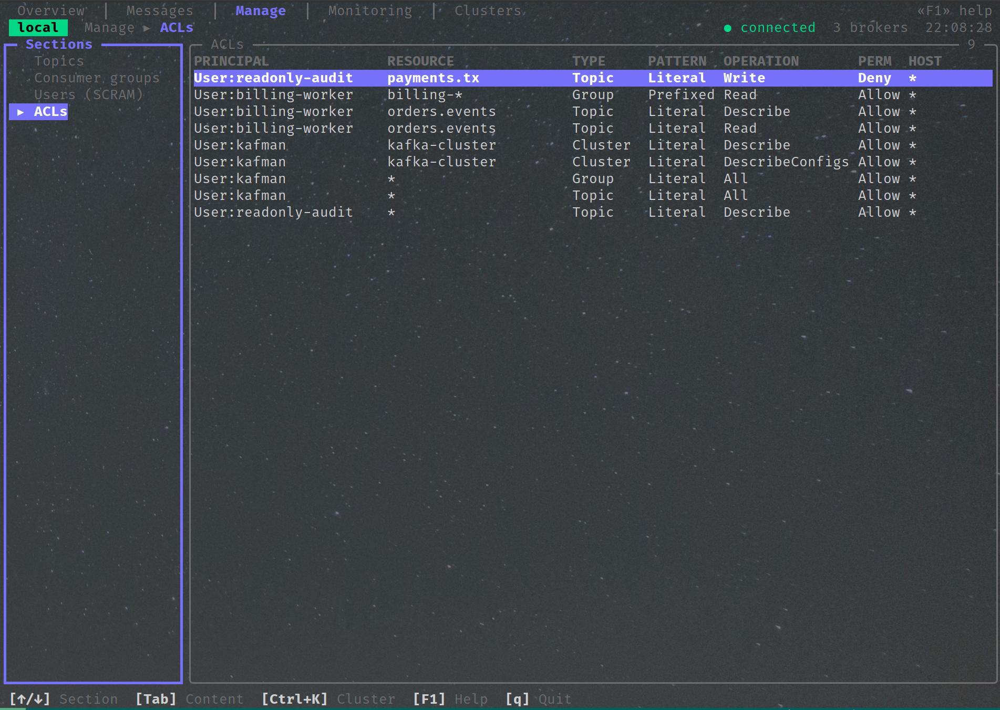
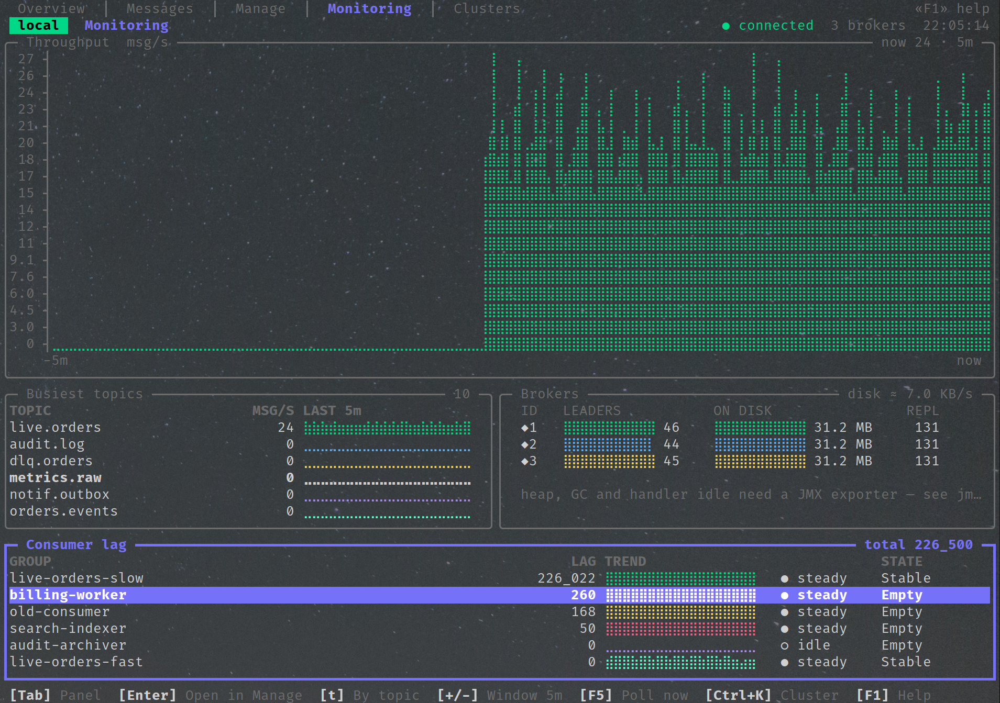
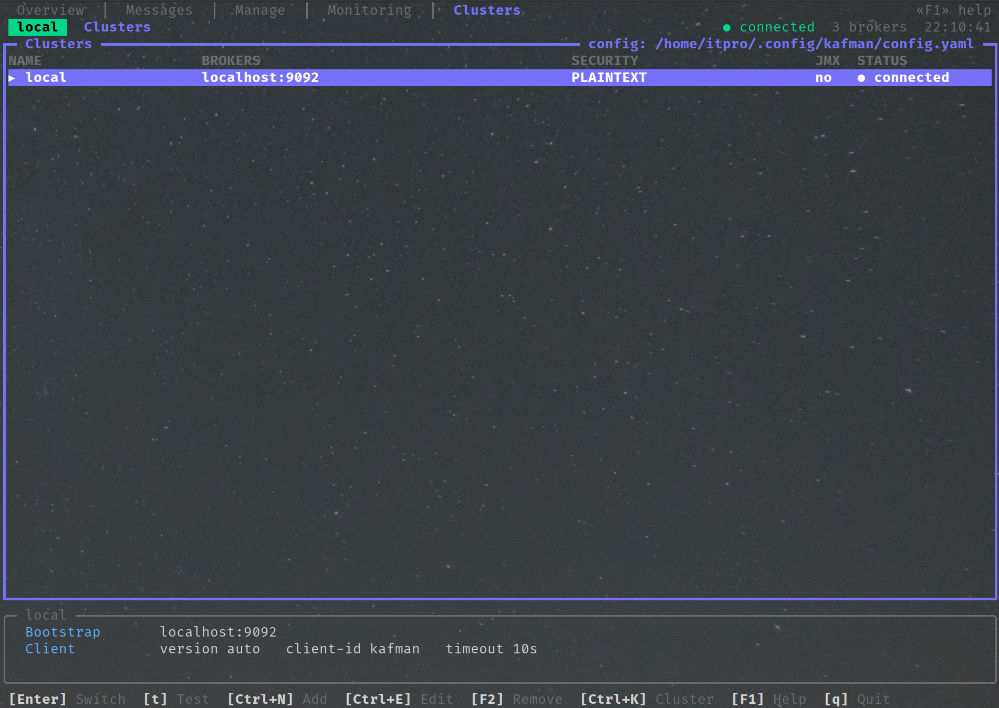

# kafman

[](https://github.com/Cyber-Watcher/kafman/actions/workflows/release.yml)
[](https://pkg.go.dev/github.com/Cyber-Watcher/kafman)
[](LICENSE)

**English** · [Русский](README_RU.md)

A terminal client for Apache Kafka: one static binary, one YAML config, five tabs.

kafman shows what a cluster is doing and lets you change it — brokers and replication, topics and
their configs, records and consumer groups, SCRAM users and ACLs, and a live dashboard — over
PLAINTEXT, SSL/mTLS, SASL_PLAINTEXT or SASL_SSL with PLAIN, SCRAM-SHA-256 or SCRAM-SHA-512.

Reading records is safe by construction: kafman assigns partitions directly, never joins a consumer
group and never commits an offset. Pointing it at production cannot move anyone's position.



## Install

Download the archive for your platform from
[Releases](https://github.com/Cyber-Watcher/kafman/releases/latest) — Linux, macOS and Windows, amd64
and arm64. Each archive holds one static binary with no runtime dependencies:

```bash
tar -xzf kafman_v0.1.0_linux_amd64.tar.gz
./kafman_v0.1.0_linux_amd64/kafman --version
```

Every release ships a `checksums.txt`:

```bash
sha256sum -c checksums.txt --ignore-missing
```

With Go 1.26 or newer:

```bash
go install github.com/Cyber-Watcher/kafman@latest
```

Or from a checkout:

```bash
make build     # CGO_ENABLED=0 go build -trimpath -ldflags …
make dist      # the same archives the release workflow publishes
./kafman --version
```

## Getting started

On first run kafman writes a config with a `local` cluster and opens on it:

```bash
kafman                                   # ~/.config/kafman/config.yaml
kafman --config ./prod.yaml              # somewhere else
kafman --cluster staging                 # start on a named cluster, once
kafman --check-all                       # test every cluster and exit; 1 if any failed
```

`--check-all` needs no terminal and is meant for scripts:

```
$ kafman --config docker/kafman.dev.yaml --check-all
✔ local  PLAINTEXT  8ms
    cluster id  kafman-test-cluster-01
      broker 1   localhost:9092
    ◆ broker 2   localhost:9192
      broker 3   localhost:9292
✔ local-ssl  SASL_SSL/SCRAM-SHA-256  56ms
    …
✖ local-bad-password  SASL_PLAINTEXT/SCRAM-SHA-512
    authentication was rejected — check sasl.username, sasl.password and that sasl.mechanism
    matches what the broker expects
kafman: 2 of 6 clusters unreachable
```

Every Kafka error kafman shows is translated like that one: the protocol's own wording is kept
underneath, but the first line says what to change.

## Configuration

One file describes every cluster. It is created with mode `0600` — it holds passwords — and saved
atomically when kafman changes it.

```yaml
current-cluster: local

ui:
  theme: dark                  # dark | light
  plain-fonts: false           # ASCII instead of Nerd Font glyphs
  timestamp-format: datetime   # datetime | ago
  refresh-interval: 5s         # how often the Monitoring collector polls
  record-buffer-size: 5000

clusters:
  - name: local
    color: "#00FF00"           # the colour of the cluster chip in the header
    brokers: [localhost:9092]
    kafka-version: "3.9.0"
    client-id: kafman
    request-timeout: 10s

  - name: prod
    color: "#FF5F5F"           # a marker that says "this one is production"
    brokers: [broker-1:9094, broker-2:9094, broker-3:9094]
    tls:
      enabled: true
      ca: certs/ca.crt         # relative paths resolve against the config's directory
      cert: certs/client.crt   # mTLS, optional
      cert-key: certs/client.key
      cert-key-passphrase: ""  # for an encrypted PKCS#8 key
      insecure: false          # never in production: it disables verification
    sasl:
      enabled: true
      mechanism: scram-sha-512 # plain | scram-sha-256 | scram-sha-512
      username: kafman
      password: swordfish     # stored in the file; see the note below
    jmx:                       # optional; without it the JMX section says so
      enabled: true
      targets:
        - broker-id: 1
          url: http://broker-1:9404/metrics
    node-exporter:             # optional; feeds the OS section of Monitoring
      enabled: true
      targets:
        - broker-id: 1
          url: http://broker-1:9100/metrics
```

The `tls`, `sasl`, `jmx` and `node-exporter` sections are optional and are left out of the file
when empty. Durations are written as `10s` or `1m30s`; a bare number is read as seconds. SASL
mechanism names are normalised, so `SCRAM-SHA-512`, `scram_sha_512` and `scram-sha512` all mean
the same thing.

### Every setting

Top level:

| Key | Default | Meaning |
|---|---|---|
| `current-cluster` | first cluster | the cluster kafman opens on; updated when you switch with `Enter` on the Clusters tab |
| `ui` | — | presentation settings shared by every cluster |
| `clusters` | — | the list of clusters, in the order the Clusters tab shows them |

`ui`:

| Key | Default | Meaning |
|---|---|---|
| `theme` | `dark` | `dark` or `light` |
| `plain-fonts` | `false` | replace braille charts and special glyphs with ASCII, for fonts that render them badly |
| `timestamp-format` | `datetime` | how record timestamps are shown: `datetime` (`2026-08-05 12:04:31`) or `ago` (`3m ago`) |
| `refresh-interval` | `5s` | how often the Monitoring collector polls the cluster and scrapes the exporters |
| `record-buffer-size` | `5000` | how many records the Messages tab keeps in memory; older ones are dropped |
| `export-dir` | working directory | where record exports (`E` / `Ctrl+E`) are written |
| `query-history` | — | maintained by kafman: the last 100 queries from the Messages tab |

Each entry of `clusters`:

| Key | Default | Meaning |
|---|---|---|
| `name` | required | unique cluster name; what `--cluster` and `current-cluster` refer to |
| `color` | none | `#RRGGBB` colour of the cluster chip in the header — the "am I on production?" cue |
| `brokers` | required | bootstrap addresses, `host:port`; one is enough, more survive a broker being down |
| `kafka-version` | client default (2.8) | the cluster's real Kafka version, e.g. `3.9.0`. Set it: an empty value negotiates as 2.8 and hides newer APIs (consumer groups, batched offsets) |
| `client-id` | `kafman` | the client id brokers see in their logs and quotas |
| `request-timeout` | `10s` | timeout for a single Kafka request |

`clusters[].tls` — transport security:

| Key | Default | Meaning |
|---|---|---|
| `enabled` | `false` | wrap the connection in TLS |
| `ca` | system pool | CA certificate to trust in addition to the system pool; relative paths resolve against the config's directory, `~/` expands |
| `cert`, `cert-key` | none | client certificate and key for mutual TLS; set together or not at all |
| `cert-key-passphrase` | none | passphrase of an encrypted PKCS#8 key |
| `insecure` | `false` | skip certificate verification — development only, never in production |

`clusters[].sasl` — authentication:

| Key | Default | Meaning |
|---|---|---|
| `enabled` | `false` | authenticate with SASL |
| `mechanism` | `plain` | `plain`, `scram-sha-256` or `scram-sha-512` (`plaintext` is accepted as a synonym of `plain`) |
| `username`, `password` | required when enabled | the credentials; the password is stored in clear, which is why the file is `0600` |

`clusters[].jmx` — the Monitoring tab's JMX section:

| Key | Default | Meaning |
|---|---|---|
| `enabled` | `false` | scrape jmx_exporter endpoints on the brokers (heap, GC, handler idle, byte rates) |
| `targets` | required when enabled | list of `broker-id` + `url` pairs, e.g. `http://broker-1:9404/metrics` |

`clusters[].node-exporter` — the Monitoring tab's OS section:

| Key | Default | Meaning |
|---|---|---|
| `enabled` | `false` | scrape node_exporter on the Kafka nodes (CPU, memory, load, disk and network, data-dir usage) |
| `targets` | required when enabled | list of `broker-id` + `url` pairs, e.g. `http://broker-1:9100/metrics` |

`clusters[].schema-registry` (`url`, `username`, `password`) is reserved: the key is accepted so
configs written today keep working when support lands, but kafman does not use it yet.

Passwords live in the file in clear, which is why kafman creates it `0600` and warns in the log if
it finds wider permissions. There is no environment-variable substitution and no keyring
integration — if that matters for your deployment, keep the config on a mount only the operator can
read.

## The tabs

### Overview — is this cluster healthy?

Cluster metadata, replication health with the worst partition named, broker load, the largest
topics and the groups that are furthest behind. `Enter` on a row opens it in the tab that can act
on it. On KRaft the Cluster panel names the metadata quorum's real leader, epoch and high
watermark, and the Brokers table places every node in the quorum (leader / follower / observer,
with its lag) next to its actual `process.roles` — via a raw `DescribeQuorum`, the same call
`kafka-metadata-quorum.sh` makes, never the misleading metadata "controller id".

### Messages — read and publish



Pick topics with `Space` and records stream in. The query line filters them with a small language
whose clauses may appear in any order:

```
value.status == "FAILED" from beginning limit 20
key starts with "ord-" and value.amount > 1000 order by timestamp desc
header.trace-id == "4b1ec90" from 2 hours ago
partition in (0, 3) and value.items[0].sku contains "ABC"
```

`Enter` opens a record with its headers and a decoded payload — JSON, XML, plain text or a hex dump,
with Confluent wire-format detection. `P` publishes (keys route through murmur2, the same hash the
Java client uses), `E` and `Ctrl+E` export the record or the whole buffer with the query and the
cluster recorded alongside.

### Manage — change the cluster



Four sections. **Topics**: create, delete, truncate, add partitions, edit configs — incrementally,
so changing retention cannot silently reset `min.insync.replicas`. **Consumer groups**: members,
per-partition offsets with the hosts the consumers run on, and a reset (to-earliest, to-latest,
to-offset, to-datetime, shift-by) that is previewed partition by partition before it is applied. **Users (SCRAM)** and **ACLs**: create,
change a password, delete; `Deny` rules are red and sort first.

Every destructive action is confirmed, and deleting a topic requires typing its name.

<details>
<summary>More Manage screenshots: Topics, Users (SCRAM), ACLs</summary>







</details>

### Monitoring — what is it doing right now



Four sections behind a Manage-style selector. **Overview**: message rates from end-offset
deltas, retained records per topic, disk growth marked `≈` because it is an estimate over every
replica, replication-health trends and consumer lag. **Groups**: the produce rate charted
against every group's consume rate — measured from committed-offset deltas — with member
history and the partitions a group never committed on. **JMX** — when an exporter is
configured — heap, GC pauses, handler and network idle and byte rates, charted per broker.
**OS** — when node_exporter runs on the nodes — CPU, memory, load, disk and network rates, and
how full the filesystem holding each broker's data directory is, resolved through the broker's
own `log.dirs`. Nothing is written to disk; the series live in memory for up to an hour.

A number kafman cannot measure is named rather than invented: a rate needs two polls and says so
until it has them, an unmatched data directory reads `unknown`, and without an exporter the
section points at the `jmx:` or `node-exporter:` config section instead of showing zeroes.

### Clusters — switch between them



Add, edit and test connections; `t` tests one without leaving the current cluster, `Enter`
switches. A failed test shows the reason in full, not a truncated protocol error.

## Keys

`F1` lists every key for the tab you are on, along with the effective settings of the current
cluster (never its credentials) and the paths of the config and log files.

| Key | Action |
|---|---|
| `1` … `5`, `Ctrl+←/→` | move between tabs |
| `Tab` | move focus between panels |
| `Ctrl+K` | jump to the cluster list |
| `/` | filter the focused table |
| `F5` | refresh |
| `F1` | help |
| `Esc` | close the top overlay |
| `q`, `Ctrl+C` | quit |

## Development

```bash
make stack-up          # three brokers in KRaft, five listeners, JMX exporters
make stack-init        # topics, SCRAM users, ACLs, messages, groups with lag,
                       # and the live load below
make stack-live        # a producer plus two consumer groups that stay connected
make test              # unit tests
make test-integration  # against the running stack
make release-check     # vet, lint, govulncheck and the tests
make stack-down
```

The test stack is three `apache/kafka:3.9.0` brokers with PLAINTEXT, SASL_PLAINTEXT, SASL_SSL and
JMX listeners, so every connection profile is exercised against a real cluster rather than a mock.
The `live` profile adds a producer and two consumer groups that stay connected — one that keeps up
and one that deliberately cannot — because a group whose consumers have exited shows no members,
no hosts and no assignments, and those screens need something real to draw.

## Design notes

- **`internal/kafka` does not import bubbletea.** The domain layer takes a context and returns
  values; `internal/ui/commands.go` is the only seam that turns those into `tea.Cmd`.
- **Reads never join a consumer group.** Partitions are assigned directly and offsets are never
  committed — there is no code path that could move a group's position.
- **Estimates are labelled and gaps are named.** An `≈` means an estimate; a metric that needs JMX
  says so; a rate that needs a second poll says that too.
- **Every list is lazy.** Topic lists come from cached metadata; offsets, sizes and configs are
  fetched only for what is on screen.

## Releases

Every commit that lands on `main` is released. The version comes from the commits since the last
tag — [Conventional Commits](https://www.conventionalcommits.org): `feat:` raises the minor, a `!`
or `BREAKING CHANGE` the major, anything else the patch. The workflow creates the tag, cross-compiles
the five targets, writes the notes from the log and publishes them with their checksums.
`[skip release]` in a commit message lands it without a release; pushing a tag by hand releases that
exact version.

## Licence

MIT — see [LICENSE](LICENSE).
