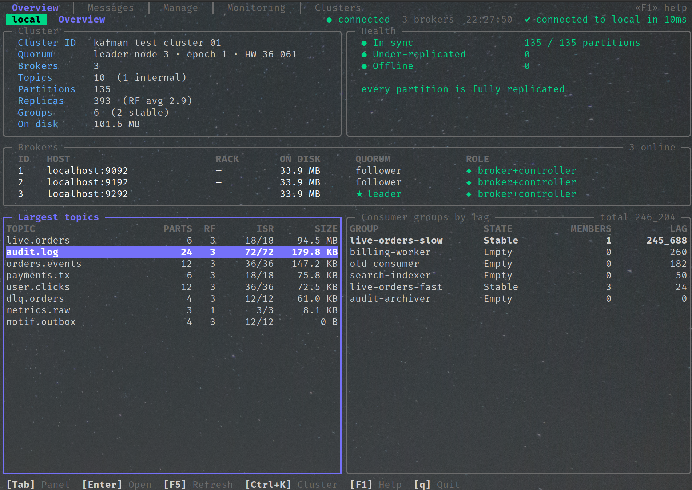
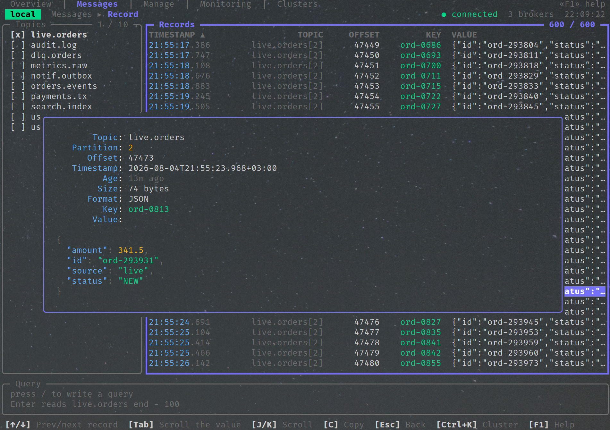
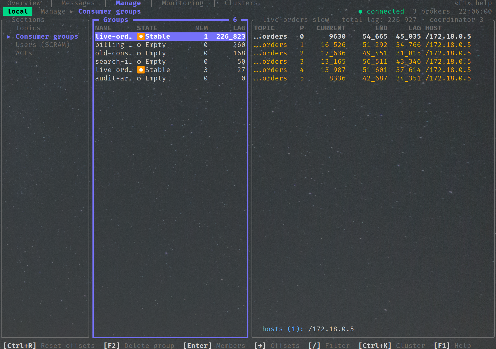
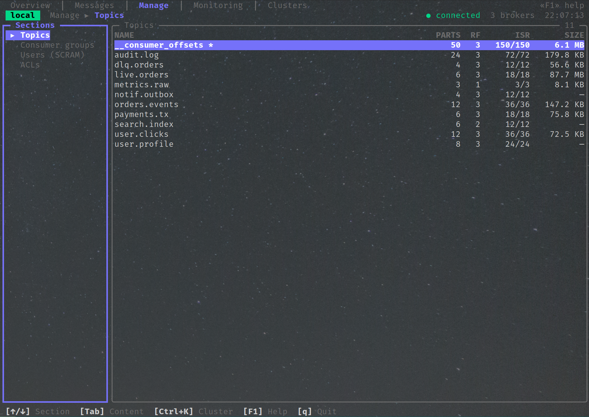
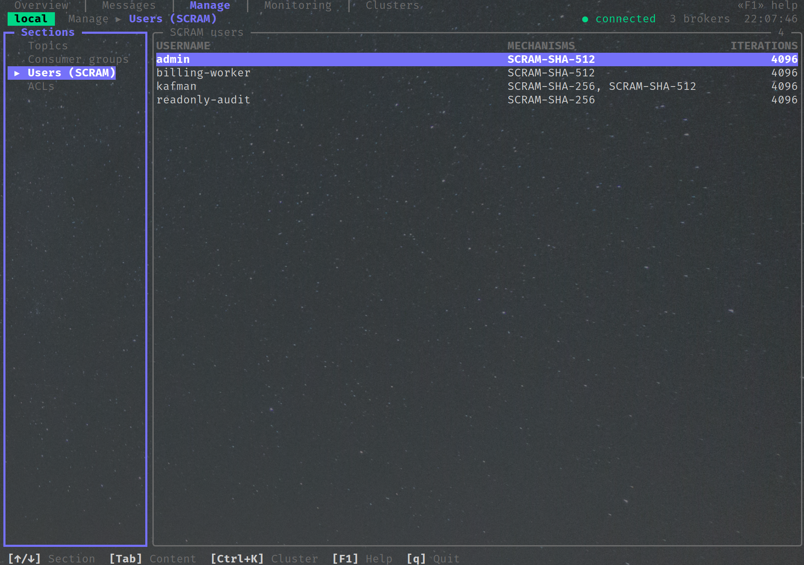
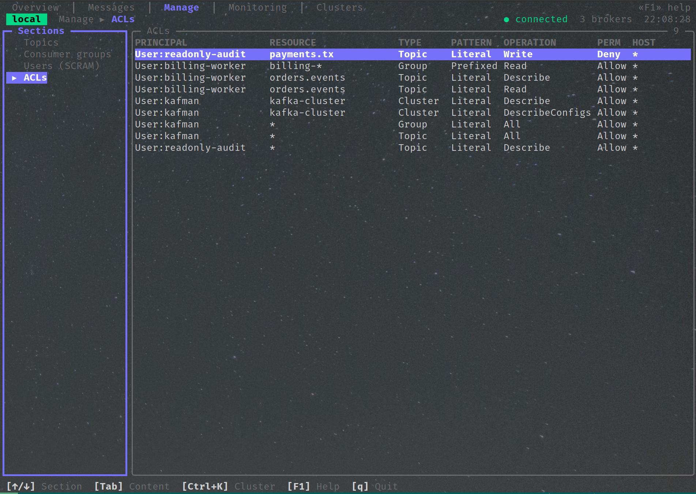
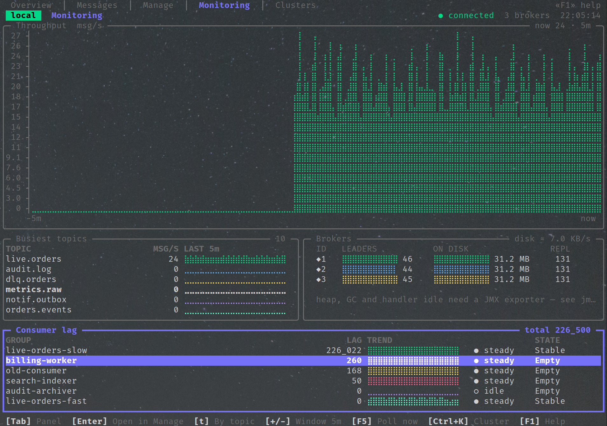
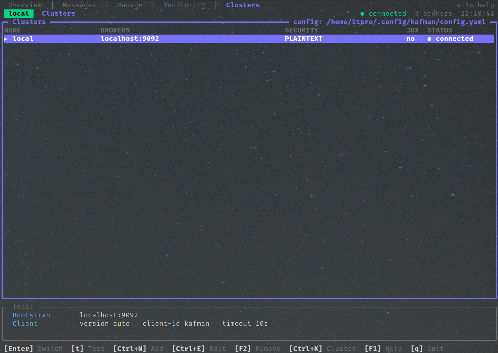

# kafman

[](https://github.com/Cyber-Watcher/kafman/actions/workflows/release.yml)
[](https://pkg.go.dev/github.com/Cyber-Watcher/kafman)
[](LICENSE)

[English](README.md) · **Русский**

Терминальный клиент для Apache Kafka: один статический бинарь, один YAML-конфиг, пять вкладок.

kafman показывает, что происходит в кластере, и позволяет это менять — брокеры и репликация,
топики и их конфиги, сообщения и consumer-группы, пользователи SCRAM и ACL, живой дашборд — через
PLAINTEXT, SSL/mTLS, SASL_PLAINTEXT или SASL_SSL с механизмами PLAIN, SCRAM-SHA-256 или
SCRAM-SHA-512.

Чтение сообщений безопасно по построению: kafman назначает партиции напрямую, никогда не вступает
в consumer-группу и никогда не коммитит офсеты. Направив его на прод, невозможно сдвинуть чью-либо
позицию чтения.



## Установка

Скачайте архив под свою платформу со страницы
[Releases](https://github.com/Cyber-Watcher/kafman/releases/latest) — Linux, macOS и Windows,
amd64 и arm64. В каждом архиве один статический бинарь без внешних зависимостей:

```bash
tar -xzf kafman_v0.1.0_linux_amd64.tar.gz
./kafman_v0.1.0_linux_amd64/kafman --version
```

К каждому релизу прилагается `checksums.txt`:

```bash
sha256sum -c checksums.txt --ignore-missing
```

С Go 1.26 или новее:

```bash
go install github.com/Cyber-Watcher/kafman@latest
```

Или из клона репозитория:

```bash
make build     # CGO_ENABLED=0 go build -trimpath -ldflags …
make dist      # те же архивы, что публикует релизный workflow
./kafman --version
```

## Первый запуск

При первом запуске kafman создаёт конфиг с кластером `local` и открывается на нём:

```bash
kafman                                   # ~/.config/kafman/config.yaml
kafman --config ./prod.yaml              # конфиг в другом месте
kafman --cluster staging                 # разовый запуск на названном кластере
kafman --check-all                       # проверить все кластеры и выйти; код 1, если хоть один недоступен
```

`--check-all` не требует терминала и предназначен для скриптов:

```
$ kafman --config docker/kafman.dev.yaml --check-all
✔ local  PLAINTEXT  8ms
    cluster id  kafman-test-cluster-01
      broker 1   localhost:9092
    ◆ broker 2   localhost:9192
      broker 3   localhost:9292
✔ local-ssl  SASL_SSL/SCRAM-SHA-256  56ms
    …
✖ local-bad-password  SASL_PLAINTEXT/SCRAM-SHA-512
    authentication was rejected — check sasl.username, sasl.password and that sasl.mechanism
    matches what the broker expects
kafman: 2 of 6 clusters unreachable
```

Каждая ошибка Kafka, которую показывает kafman, переведена на человеческий язык, как в примере
выше: формулировка протокола сохраняется ниже, но первая строка говорит, что именно исправить.

## Конфигурация

Один файл описывает все кластеры. Он создаётся с правами `0600` — внутри пароли — и сохраняется
атомарно, когда kafman его меняет.

```yaml
current-cluster: local

ui:
  theme: dark                  # dark | light
  plain-fonts: false           # ASCII вместо символов Nerd Font
  timestamp-format: datetime   # datetime | ago
  refresh-interval: 5s         # как часто опрашивает сборщик вкладки Monitoring
  record-buffer-size: 5000

clusters:
  - name: local
    color: "#00FF00"           # цвет чипа кластера в шапке
    brokers: [localhost:9092]
    kafka-version: "3.9.0"
    client-id: kafman
    request-timeout: 10s

  - name: prod
    color: "#FF5F5F"           # маркер «это продакшен»
    brokers: [broker-1:9094, broker-2:9094, broker-3:9094]
    tls:
      enabled: true
      ca: certs/ca.crt         # относительные пути разрешаются от каталога конфига
      cert: certs/client.crt   # mTLS, необязательно
      cert-key: certs/client.key
      cert-key-passphrase: ""  # для зашифрованного ключа PKCS#8
      insecure: false          # никогда в проде: отключает проверку сертификата
    sasl:
      enabled: true
      mechanism: scram-sha-512 # plain | scram-sha-256 | scram-sha-512
      username: kafman
      password: swordfish     # хранится в файле; см. замечание ниже
    jmx:                       # необязательно; без него подраздел JMX так и скажет
      enabled: true
      targets:
        - broker-id: 1
          url: http://broker-1:9404/metrics
    node-exporter:             # необязательно; питает подраздел OS в Monitoring
      enabled: true
      targets:
        - broker-id: 1
          url: http://broker-1:9100/metrics
```

Секции `tls`, `sasl`, `jmx` и `node-exporter` необязательны и не записываются в файл, пока
пусты. Длительности пишутся как `10s` или `1m30s`; голое число читается как секунды. Имена
SASL-механизмов нормализуются, поэтому `SCRAM-SHA-512`, `scram_sha_512` и `scram-sha512`
означают одно и то же.

### Все параметры

Верхний уровень:

| Ключ | По умолчанию | Значение |
|---|---|---|
| `current-cluster` | первый кластер | кластер, на котором kafman открывается; обновляется при переключении по `Enter` на вкладке Clusters |
| `ui` | — | настройки отображения, общие для всех кластеров |
| `clusters` | — | список кластеров в том порядке, в котором их показывает вкладка Clusters |

`ui`:

| Ключ | По умолчанию | Значение |
|---|---|---|
| `theme` | `dark` | `dark` или `light` |
| `plain-fonts` | `false` | заменить braille-графики и специальные символы на ASCII — для шрифтов, которые их плохо отображают |
| `timestamp-format` | `datetime` | формат времени сообщений: `datetime` (`2026-08-05 12:04:31`) или `ago` (`3m ago`) |
| `refresh-interval` | `5s` | как часто сборщик Monitoring опрашивает кластер и экспортеры |
| `record-buffer-size` | `5000` | сколько сообщений вкладка Messages держит в памяти; старые вытесняются |
| `export-dir` | рабочий каталог | куда пишутся экспорты сообщений (`E` / `Ctrl+E`) |
| `query-history` | — | ведётся самим kafman: последние 100 запросов вкладки Messages |

Каждый элемент `clusters`:

| Ключ | По умолчанию | Значение |
|---|---|---|
| `name` | обязателен | уникальное имя кластера; на него ссылаются `--cluster` и `current-cluster` |
| `color` | нет | цвет `#RRGGBB` чипа кластера в шапке — маркер «это прод» |
| `brokers` | обязателен | bootstrap-адреса `host:port`; достаточно одного, несколько переживают падение брокера |
| `kafka-version` | умолчание клиента (2.8) | реальная версия Kafka кластера, например `3.9.0`. Указывайте её: пустое значение согласуется как 2.8 и прячет новые API (consumer-группы, batched-офсеты) |
| `client-id` | `kafman` | client id, который брокеры видят в логах и квотах |
| `request-timeout` | `10s` | таймаут одного Kafka-запроса |

`clusters[].tls` — защита транспорта:

| Ключ | По умолчанию | Значение |
|---|---|---|
| `enabled` | `false` | обернуть соединение в TLS |
| `ca` | системный пул | CA-сертификат в дополнение к системному пулу; относительные пути — от каталога конфига, `~/` раскрывается |
| `cert`, `cert-key` | нет | клиентский сертификат и ключ для mTLS; задаются вместе или никак |
| `cert-key-passphrase` | нет | пароль зашифрованного ключа PKCS#8 |
| `insecure` | `false` | не проверять сертификаты — только для разработки, никогда в проде |

`clusters[].sasl` — аутентификация:

| Ключ | По умолчанию | Значение |
|---|---|---|
| `enabled` | `false` | аутентифицироваться через SASL |
| `mechanism` | `plain` | `plain`, `scram-sha-256` или `scram-sha-512` (`plaintext` принимается как синоним `plain`) |
| `username`, `password` | обязательны при включении | учётные данные; пароль хранится открытым текстом, поэтому файл создаётся с правами `0600` |

`clusters[].jmx` — подраздел JMX вкладки Monitoring:

| Ключ | По умолчанию | Значение |
|---|---|---|
| `enabled` | `false` | опрашивать jmx_exporter на брокерах (heap, GC, простой обработчиков, байтовые скорости) |
| `targets` | обязательны при включении | список пар `broker-id` + `url`, например `http://broker-1:9404/metrics` |

`clusters[].node-exporter` — подраздел OS вкладки Monitoring:

| Ключ | По умолчанию | Значение |
|---|---|---|
| `enabled` | `false` | опрашивать node_exporter на нодах Kafka (CPU, память, load average, диск и сеть, заполненность каталога данных) |
| `targets` | обязательны при включении | список пар `broker-id` + `url`, например `http://broker-1:9100/metrics` |

`clusters[].schema-registry` (`url`, `username`, `password`) зарезервирована: ключ принимается,
чтобы написанные сегодня конфиги продолжили работать, когда поддержка появится, но пока kafman
её не использует.

Пароли лежат в файле открытым текстом — поэтому kafman создаёт его с правами `0600` и пишет
предупреждение в лог, если находит права шире. Подстановки переменных окружения и интеграции с
keyring нет — если для вашего развёртывания это важно, держите конфиг на разделе, читать который
может только оператор.

## Вкладки

### Overview — здоров ли кластер?

Метаданные кластера, здоровье репликации с указанием худшей партиции, нагрузка брокеров,
крупнейшие топики и самые отстающие группы. `Enter` на строке открывает её в той вкладке, которая
умеет с ней работать. На KRaft панель Cluster называет настоящего лидера кворума метаданных, его
эпоху и high watermark, а таблица Brokers указывает место каждой ноды в кворуме (leader / follower
/ observer, с отставанием) рядом с её реальными `process.roles` — через сырой запрос
`DescribeQuorum`, тот же вызов, который делает `kafka-metadata-quorum.sh`, и никогда — через
вводящий в заблуждение «controller id» из метаданных.

### Messages — читать и публиковать



Отметьте топики клавишей `Space` — и сообщения потекут на экран. Строка запроса фильтрует их
небольшим языком, клаузы которого могут идти в любом порядке:

```
value.status == "FAILED" from beginning limit 20
key starts with "ord-" and value.amount > 1000 order by timestamp desc
header.trace-id == "4b1ec90" from 2 hours ago
partition in (0, 3) and value.items[0].sku contains "ABC"
```

`Enter` открывает сообщение с заголовками и декодированным содержимым — JSON, XML, обычный текст
или hex-дамп, с распознаванием Confluent wire-format. `P` публикует (ключи распределяются через
murmur2 — тем же хэшем, что у Java-клиента), `E` и `Ctrl+E` экспортируют сообщение или весь буфер,
записывая рядом запрос и кластер.

### Manage — менять кластер



Четыре секции. **Topics**: создать, удалить, очистить, добавить партиции, править конфиги —
инкрементально, чтобы смена retention не могла молча сбросить `min.insync.replicas`.
**Consumer groups**: участники, офсеты по партициям с хостами, на которых работают консьюмеры, и
сброс офсетов (to-earliest, to-latest, to-offset, to-datetime, shift-by) с предпросмотром по
каждой партиции до применения. **Users (SCRAM)** и **ACLs**: создать, сменить пароль, удалить;
правила `Deny` подсвечены красным и сортируются первыми.

Каждое разрушающее действие подтверждается, а удаление топика требует ввести его имя.

<details>
<summary>Ещё скриншоты Manage: Topics, Users (SCRAM), ACLs</summary>







</details>

### Monitoring — что происходит прямо сейчас



Четыре подраздела за селектором в стиле Manage. **Overview**: скорость сообщений из дельт
конечных офсетов, сколько записей хранит каждый топик, рост диска, помеченный `≈`, потому что
это оценка по всем репликам, тренды здоровья репликации и лаг consumer-групп. **Groups**:
скорость записи кластера на одном графике со скоростью чтения каждой группы — она измеряется по
дельтам закоммиченных офсетов — плюс история числа участников и партиции, в которые группа ни
разу не коммитила. **JMX** — при настроенном экспортере — heap, паузы GC, простой обработчиков
и сети, байтовые скорости, с графиками по брокерам. **OS** — когда на нодах работает
node_exporter — CPU, память, load average, скорости диска и сети и заполненность файловой
системы с каталогом данных каждого брокера, найденной через его собственный `log.dirs`. На диск
ничего не пишется; ряды живут в памяти до часа.

Число, которое kafman не может измерить, называется по имени, а не выдумывается: скорости нужны
два опроса, и до второго так и написано; несопоставленный каталог данных читается как `unknown`;
а без экспортера подраздел указывает на секцию `jmx:` или `node-exporter:` вместо того, чтобы
показывать нули.

### Clusters — переключаться между ними



Добавляйте, редактируйте и проверяйте подключения; `t` проверяет кластер, не покидая текущего,
`Enter` переключает. Проваленная проверка показывает причину целиком, а не обрезанную ошибку
протокола.

## Клавиши

`F1` показывает все клавиши текущей вкладки вместе с действующими настройками текущего кластера
(но никогда — его учётными данными) и путями к файлам конфига и лога.

| Клавиша | Действие |
|---|---|
| `1` … `5`, `Ctrl+←/→` | переход между вкладками |
| `Tab` | переключение фокуса между панелями |
| `Ctrl+K` | перейти к списку кластеров |
| `/` | фильтр сфокусированной таблицы |
| `F5` | обновить |
| `F1` | справка |
| `Esc` | закрыть верхний оверлей |
| `q`, `Ctrl+C` | выход |

## Разработка

```bash
make stack-up          # три брокера в KRaft, пять listener'ов, JMX-экспортеры
make stack-init        # топики, пользователи SCRAM, ACL, сообщения, группы с лагом
                       # и живая нагрузка (см. ниже)
make stack-live        # продюсер и две постоянно подключённые consumer-группы
make test              # юнит-тесты
make test-integration  # против запущенного стенда
make release-check     # vet, lint, govulncheck и тесты
make stack-down
```

Тестовый стенд — три брокера `apache/kafka:3.9.0` с listener'ами PLAINTEXT, SASL_PLAINTEXT,
SASL_SSL и JMX, так что каждый профиль подключения проверяется на настоящем кластере, а не на
моке. Профиль `live` добавляет продюсера и две постоянно подключённые consumer-группы — одну,
которая успевает, и одну, которая нарочно нет, — потому что группа, чьи консьюмеры завершились, не
показывает ни участников, ни хостов, ни назначений, а этим экранам нужно рисовать что-то
настоящее.

## Замечания об архитектуре

- **`internal/kafka` не импортирует bubbletea.** Доменный слой принимает контекст и возвращает
  значения; `internal/ui/commands.go` — единственный шов, превращающий их в `tea.Cmd`.
- **Чтение никогда не вступает в consumer-группу.** Партиции назначаются напрямую, офсеты никогда
  не коммитятся — в коде нет пути, который мог бы сдвинуть позицию группы.
- **Оценки помечены, пробелы названы.** `≈` означает оценку; метрика, которой нужен JMX, так и
  говорит; скорость, которой нужен второй опрос, — тоже.
- **Каждый список ленив.** Списки топиков берутся из кэшированных метаданных; офсеты, размеры и
  конфиги запрашиваются только для того, что на экране.

## Релизы

Каждый коммит, попавший в `main`, выпускается релизом. Версия выводится из коммитов с последнего
тега — [Conventional Commits](https://www.conventionalcommits.org): `feat:` поднимает минорную
версию, `!` или `BREAKING CHANGE` — мажорную, всё остальное — патч. Workflow создаёт тег, собирает
пять платформ, пишет заметки к релизу из лога и публикует их вместе с контрольными суммами.
`[skip release]` в сообщении коммита вливает его без релиза; пуш тега вручную выпускает ровно эту
версию.

## Лицензия

MIT — см. [LICENSE](LICENSE).
